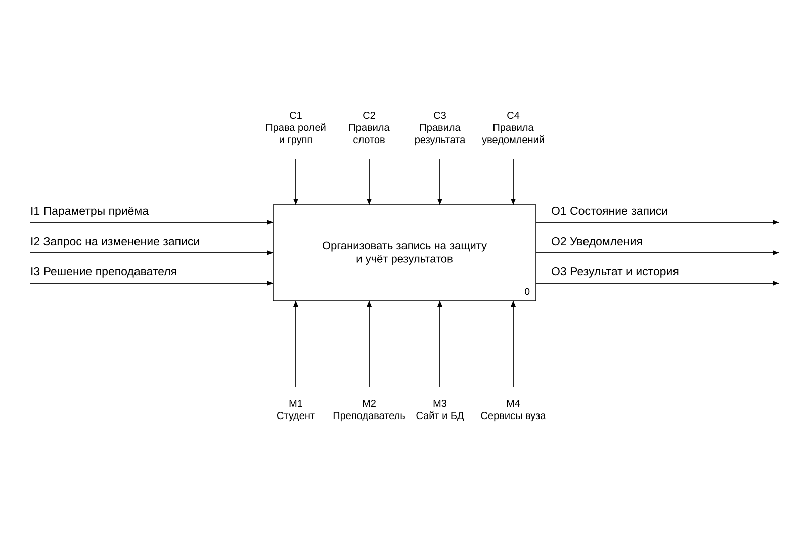
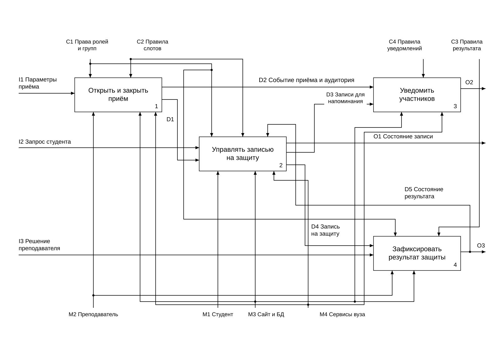
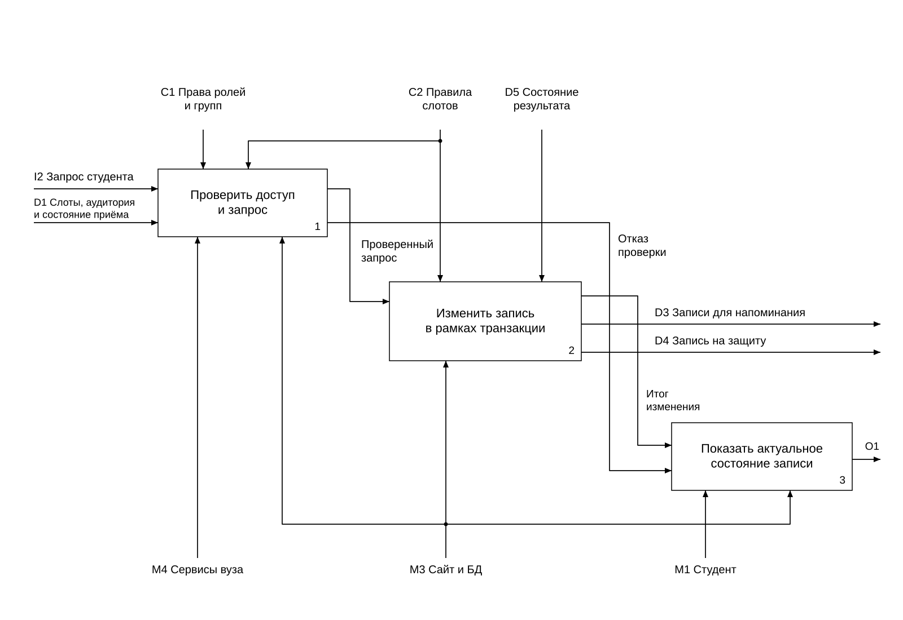

# Функциональная модель записи на защиту лабораторных работ

**Практическая работа № 3 по дисциплине «Проектирование информационных систем».**  
Тема: функциональное моделирование в нотации IDEF0.  
Вариант 2 — запись на консультации к преподавателям.

Выполнили: Логданиди Кирилл, Газабагандов Шейхахмед  
Группа: K3341  
Преподаватель: Духанов Алексей Валентинович

**Цель работы:** описать функции университетского сайта записи на защиту, связи между ними и правила, по которым они выполняются.

## 1 Объект и границы модели

Модель описывает университетский сайт из работы № 2, от настройки очного или дистанционного приёма до сохранения отметки. Преподаватель проводит защиту и оценивает работу. Сайт ведёт слоты, записи и уведомления.

**Точка зрения:** аналитик, проектирующий сайт для студентов и преподавателей. Роли, время приёма и право записи по группе взяты из анализа очной защиты в работе № 1.

## 2 Контекстная диаграмма A-0

Граница контекстного блока отделяет функции сайта от действий студентов, преподавателей и внешних сервисов.

*Рисунок 1. Контекстная диаграмма системы записи на защиту.*

| Обозначение | Содержание |
| --- | --- |
| Входы (I) | **I1** — параметры приёма или команда отмены: предмет, группы, дата, формат. **I2** — запрос студента занять, перенести или отменить слот, изменить название работы. **I3** — посещение и решение преподавателя «Сдал», «Не сдал» или «Не пришёл». |
| Управления (C) | **C1** — права по ролям, группам и владельцам записей. **C2** — один студент и одна работа на слот 10 минут, без сдвига других мест. **C3** — ручная отметка, пустой результат до оценки, сохранение истории. **C4** — уведомления всей аудитории и одно напоминание студенту за час до его первого слота. |
| Выходы (O) | **O1** — список слотов, подтверждение или причина отказа. **O2** — сообщения на сайте и по университетской почте. **O3** — история посещений и результаты. |
| Механизмы (M) | **M1** — студент. **M2** — преподаватель. **M3** — сайт и база данных. **M4** — университетский вход, данные групп и почта. |

## 3 Декомпозиция A0

На первом уровне выделены четыре функции. На стрелках D1–D5 показаны данные, которыми обмениваются функции. Пересечение линий обозначает соединение только там, где стоит точка.

*Рисунок 2. Функции системы и потоки данных между ними.*

| Блок | Назначение | Что передаёт |
| --- | --- | --- |
| A1. Открыть и закрыть приём | Преподаватель задаёт условия приёма. Сайт открывает запись на десятиминутные слоты или закрывает её при отмене. | В A2 — слоты, аудиторию и состояние приёма (D1). В A3 — событие открытия или отмены и аудиторию (D2). |
| A2. Управлять записью на защиту | Сайт проверяет доступ, создаёт, переносит, отменяет запись или меняет название работы до выставления результата. | В A3 — записи для напоминания (D3). В A4 — запись на защиту (D4). Пользователю — состояние записи (O1). |
| A3. Уведомить участников | Сайт определяет адресатов и отправляет сообщения при открытии и отмене, а также напоминает записавшимся студентам. | Уведомления на сайте и по почте (O2). |
| A4. Зафиксировать результат защиты | Преподаватель вручную выставляет отметку. Сайт связывает её с посещением и сохраняет историю. | В A2 — состояние результата (D5), чтобы ограничить изменение завершённой записи. Участникам — результат и история (O3). |

## 4 Декомпозиция A2

Управление записью детализировано отдельно, потому что несколько студентов могут одновременно выбрать один слот. Тот же блок отвечает за сохранение старого места при неудачном переносе.

*Рисунок 3. Проверка запроса, изменение записи и показ результата.*

| Блок | Действие и результат |
| --- | --- |
| A21. Проверить доступ и запрос | Проверить университетский профиль, доступ группы, состояние приёма и право изменять свою запись. Передать подтверждённый запрос в A22 или причину отказа в A23. |
| A22. Изменить запись в рамках транзакции | Проверить состояние слота и записи в момент изменения. При переносе закрепить новое место и освободить прежнее как одно действие. При отказе оставить исходную запись. Подготовить актуальные сведения для напоминания и учёта защиты. |
| A23. Показать актуальное состояние записи | Показать подтверждение, причину отказа или обновлённый список. При обрыве связи предупредить, что результат ещё не подтверждён, затем сверить состояние после восстановления. |

## 5 Проверка модели по сценариям

Проверки ниже относятся к модели. Ожидаемое поведение взято из требований работы № 2.

| Сценарий | Ожидаемый результат | Блоки и требования |
| --- | --- | --- |
| Преподаватель открыл приём на 14:00–16:00 | Сайт создаёт 12 слотов по 10 минут и уведомляет выбранную аудиторию. | A1, A3; F2–F4 |
| Два студента пытаются занять 14:10–14:20 | Подтверждается одна запись. Второй студент видит, что слот занят, и может выбрать другое время. Повтор запроса не создаёт дубль. | A21–A23; F5, F12, N2 |
| При переносе новый слот уже занят | Исходное место остаётся за студентом. | A22, A23; F7, N2 |
| Преподаватель отменил приём | Запись закрывается, вся выбранная аудитория получает уведомление. При создании нового приёма список записей пуст. | A1–A3; F10 |
| У студента два слота в одном приёме | За час до первого слота ему приходит одно напоминание с обоими слотами. | A2, A3; F11 |
| Студент не пришёл и потом записался повторно | Преподаватель вручную ставит «Не пришёл». Старая отметка остаётся в истории, новая запись создаётся без результата. | A2, A4; F8, F9 |

В модели сохранены границы первых двух работ: университетские сервисы подтверждают личность и группы, сайт распределяет время приёма и сохраняет историю, преподаватель принимает решение о результате. В A0 показано, какие данные связывают эти функции, а в A2 — при каких условиях меняется запись.
